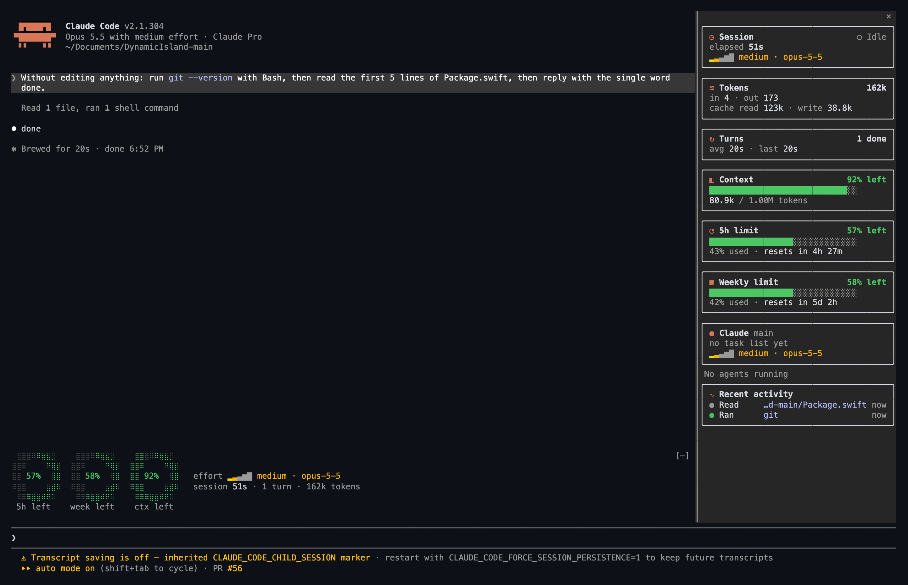

<div align="center">

# ◕ Claude Widget Kit

### Your Claude Code session, at a glance.

**A mods pack for Claude Code: usage rings, effort, task ETA and a live session dashboard (tokens, turns, context, limits, agents, activity), drawn right inside the terminal UI.**

[](https://github.com/MakeItEzzz555/claude-widget-kit/actions/workflows/validate.yml)


[](LICENSE)

**In-UI · Zero dependencies · Tested · MIT-licensed**

[Install](#install) · [What you get](#what-you-get) · [How it works](#how-it-works) · [Widget ideas](IDEAS.md) · [Codex version](https://github.com/MakeItEzzz555/codex-widget-kit)

</div>

---

### How much of my limit is left? How many tokens has this session used? How long are my turns? What did Claude just touch?

Claude Code already knows. **Claude Widget Kit puts it on screen.** The band above the prompt holds three braille rings, a heat-coloured effort meter, a progress bar that learns your plan's pace and a one-line session summary. The side panel is a dashboard: Session, Tokens, Turns, Context, 5h and weekly limits with reset countdowns, a card per agent, and a privacy-safe feed of recent tool activity. Nothing to run alongside it: the widgets live inside Claude Code.



*A real session, captured from the terminal: every number in it came from Claude Code's own events (the turn above took 20 s, and the Turns card says so).*

## The mods

### `turn-meters`

| Widget | Where | What it shows |
|---|---|---|
| **5h · week · ctx rings** | Band above the prompt | Share of each limit left, lit clockwise; green > 50 %, amber > 20 %, red below |
| **Effort meter** | Band and cards | `▂▃▄▆█` ticks from low to max, with the model |
| **Task bar + ETA** | Band and cards | Steps done, current step, and a time estimate labelled `est.` from the pace so far |
| **Session summary** | Band | Elapsed time, completed turns, the live turn's time, session tokens |
| **Session** | Panel | Working or idle, elapsed, this turn's time, effort and model |
| **Tokens** | Panel | Session totals for input, output, cache read and cache write, with an output-per-turn sparkline. Every agent's turns count |
| **Turns** | Panel | Completed main-loop turns, average and last length, a sparkline of turn lengths. A count, never "n of m": there is no turn quota |
| **Context** | Panel | Context left, tokens / window, and how often it was compacted |
| **5h limit · Weekly limit** | Panel | Share left and used, and the reset countdown when Claude Code reports one |
| **Agents** | Panel | One card per agent: name, kind, current task, progress, effort, up to 9 plus "+N more" |
| **Recent activity** | Panel | The last 8 tool calls: files read or edited (last two path parts), commands (program and subcommand), searches, fetched hosts, MCP calls, agent starts, compactions; failures in red; a count of files edited |
| **`progress` tool** | For Claude | Lets Claude show a progress bar for multi-step work that has no task list |

Task data comes from `TodoWrite`, the Task tools (`TaskCreate`/`TaskUpdate`/`TaskList`) or the mod's own `progress` tool. Readings appear as soon as Claude Code has them and say "Waiting for…" until then. On non-terminal surfaces the rings degrade to plain percentages. The panel lays its cards two a row once it is 88 columns wide. [TELEMETRY.md](TELEMETRY.md) lists the source of every number.

More widgets are on the way. See [IDEAS.md](IDEAS.md).

## Install

### In Claude Code

```text
/plugin marketplace add MakeItEzzz555/claude-widget-kit
/plugin install turn-meters@claude-widget-kit
/reload-plugins
```

### From a shell

```bash
claude plugin marketplace add MakeItEzzz555/claude-widget-kit
claude plugin install turn-meters@claude-widget-kit
```

### Let Claude install it

Paste the prompt from [INSTALL_PROMPT.md](INSTALL_PROMPT.md) into Claude Code.

Requires a Claude Code build with mods support (tested with **2.1.304**). The agents panel docks on the right in the fullscreen layout and waits for a terminal at least 144 columns wide. Reopen it with `/agent-panel`.

## How it works

```text
  Claude Code engine ──events──▶ turn-meters (hooks/register.tsx)
   session.measure  ─┐              │ keeps small state atoms:
   turn.start/step  ─┤              │ loops · plans · agents · usage · insights · now
   turn.complete    ─┤              │
   session.compact  ─┤              │
   tool.call        ─┤              ▼
   agent.spawn      ─┘     ui.render ▸ AbovePrompt band  +  Pane "agent-panel"
```

- **Pure core.** `hooks/meters.ts` holds the pace estimator, ETA formatting and the braille ring rasteriser. It's covered by `claude plugin test`.
- **Never in the way.** Every bookkeeping step is wrapped so a failure can't disturb a model request or a tool call. Unchanged readings don't trigger redraws.
- **Private.** It reads the usage, model, effort, task titles, agent list, turn token counts and tool names the engine already exposes. The activity feed keeps a file's last two path parts, a command's program and subcommand (`npm test`) or a host name: never contents, arguments or output. No network, no files.
- **Bounded.** The activity feed keeps 8 rows, the sparklines 32 samples, the edited-files list 500 paths. The clock ticks every second only while a turn is live, every ten seconds otherwise.

## Develop

```bash
git clone https://github.com/MakeItEzzz555/claude-widget-kit.git
cd claude-widget-kit
claude plugin validate .
claude plugin test plugins/turn-meters
```

To load your working copy, add the folder as a local marketplace (`claude plugin marketplace add ./claude-widget-kit`). Edit the files, then run `/reload-plugins`.

## Uninstall

```text
/plugin uninstall turn-meters@claude-widget-kit
/plugin marketplace remove claude-widget-kit
```

[Widget ideas](IDEAS.md) · [Security](SECURITY.md) · [Contributing](CONTRIBUTING.md) · [Changelog](CHANGELOG.md) · [Codex Widget Kit](https://github.com/MakeItEzzz555/codex-widget-kit)

---

<div align="center">

**Claude Widget Kit: see the work, not just the words.**

*Community project. Not affiliated with Anthropic. Claude and Claude Code are trademarks of Anthropic.*

</div>
