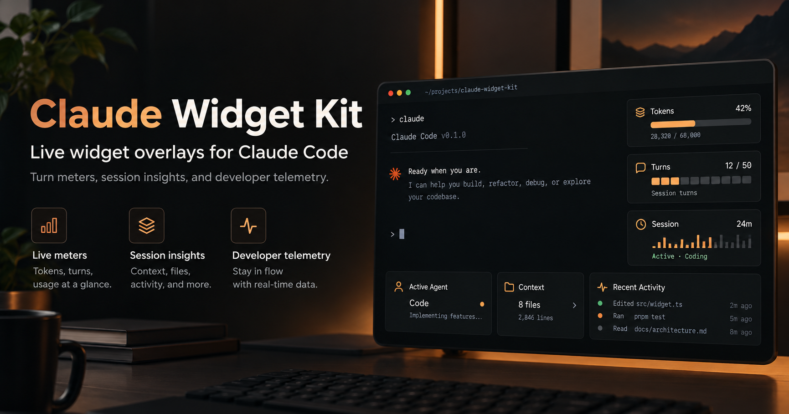

<div align="center">

# Claude Widget Kit

### Your Claude Code session, at a glance.

**A mods pack for Claude Code: usage rings, effort, task ETA, and an agents panel inside the terminal.**



<sub>Conceptual UI illustration of the visual direction, not a live screenshot. Some pictured cards and figures are planned for v0.2.0; see the supported features below.</sub>

[](https://github.com/MakeItEzzz555/claude-widget-kit/actions/workflows/validate.yml)


[](LICENSE)

**In-UI · Zero dependencies · Tested · MIT-licensed**

[Install](#install) · [What you get](#what-you-get) · [How it works](#how-it-works) · [Widget ideas](IDEAS.md) · [Codex version](https://github.com/MakeItEzzz555/codex-widget-kit)

</div>

---

### How much of my limit is left? How hard is it thinking? When will it be done? What are my agents doing?

Claude Code already knows. **Claude Widget Kit puts it on screen.** A band above the prompt holds three braille rings, a heat-coloured effort meter and a progress bar that learns your plan's pace. A side panel gives every running agent its own live card. Nothing to run alongside it: the widgets live inside Claude Code.


## The mods

### `turn-meters`

| Widget | Where | What it shows |
|---|---|---|
| **5h · week · ctx rings** | Band above the prompt | Share of each limit left, lit clockwise; green > 50 %, amber > 20 %, red below |
| **Effort meter** | Band and cards | `▂▃▄▆█` ticks from low to max, with the model |
| **Task bar + ETA** | Band and cards | Steps done, current step, and a time estimate from the pace so far |
| **Agents panel** | Right-hand pane (`/agent-panel`) | One card per agent: name, kind, current task, progress, effort, up to 9 plus "+N more" |
| **`progress` tool** | For Claude | Lets Claude show a progress bar for multi-step work that has no task list |

Task data comes from `TodoWrite`, the Task tools (`TaskCreate`/`TaskUpdate`/`TaskList`) or the mod's own `progress` tool. Rings appear as soon as Claude Code has a usage reading. On non-terminal surfaces they degrade to plain percentages.

More widgets are on the way. See [IDEAS.md](IDEAS.md).

## Install

### In Claude Code

```text
/plugin marketplace add MakeItEzzz555/claude-widget-kit
/plugin install turn-meters@claude-widget-kit
/reload-plugins
```

### From a shell

```bash
claude plugin marketplace add MakeItEzzz555/claude-widget-kit
claude plugin install turn-meters@claude-widget-kit
```

### Let Claude install it

Paste the prompt from [INSTALL_PROMPT.md](INSTALL_PROMPT.md) into Claude Code.

Requires a Claude Code build with mods support (tested with **2.1.304**). The agents panel docks on the right in the fullscreen layout and waits for a terminal at least 144 columns wide. Reopen it with `/agent-panel`.

## How it works

```text
  Claude Code engine ──events──▶ turn-meters (hooks/register.tsx)
   session.measure  ─┐              │ keeps small state atoms:
   turn.step        ─┤              │ loops · plans · agents · usage · now
   TodoWrite/Task*  ─┤              ▼
   agent.spawn      ─┘     ui.render ▸ AbovePrompt band  +  Pane "agent-panel"
```

- **Pure core.** `hooks/meters.ts` holds the pace estimator, ETA formatting and the braille ring rasteriser. It's covered by `claude plugin test`.
- **Never in the way.** Every bookkeeping step is wrapped so a failure can't disturb a model request or a tool call. Unchanged readings don't trigger redraws.
- **Private.** It reads the usage, model, effort, task titles and agent list the engine already exposes, and nothing else. No network, no files.

## Develop

```bash
git clone https://github.com/MakeItEzzz555/claude-widget-kit.git
cd claude-widget-kit
claude plugin validate .
claude plugin test plugins/turn-meters
```

To load your working copy, add the folder as a local marketplace (`claude plugin marketplace add ./claude-widget-kit`). Edit the files, then run `/reload-plugins`.

## Uninstall

```text
/plugin uninstall turn-meters@claude-widget-kit
/plugin marketplace remove claude-widget-kit
```

[Widget ideas](IDEAS.md) · [Security](SECURITY.md) · [Contributing](CONTRIBUTING.md) · [Changelog](CHANGELOG.md) · [Codex Widget Kit](https://github.com/MakeItEzzz555/codex-widget-kit)

---

<div align="center">

**Claude Widget Kit: see the work, not just the words.**

*Community project. Not affiliated with Anthropic. Claude and Claude Code are trademarks of Anthropic.*

</div>
